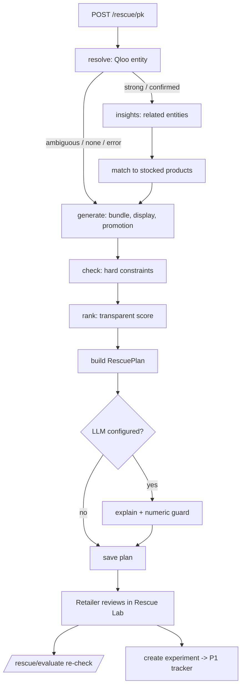

# Decision Engine (Person 2)

The decision engine turns one slow-moving product into **up to three ranked, feasible stock-rescue experiments**. Each experiment comes with its evidence, its economics and an honest list of limitations. It lives in `backend/app/services/` (deterministic logic), `backend/app/agent/` (pipeline, adapters, LLM) and `backend/app/api/rescue.py` (HTTP).

> Division of responsibility: **Qloo** supplies cultural signals (hypotheses). **Deterministic Python** calculates every number and enforces every hard rule. **The LLM** only writes optional plain-language text, behind a guard that rejects any number it did not get from the code. **The retailer** approves every action. **Recorded outcomes** decide what worked.

---

## 1. Agent workflow

The "agent" is a **bounded, deterministic pipeline**: seven fixed stages, no loops. It branches on what each stage returns. For example, no Qloo match means insights are skipped, and a failed stage still produces a partial plan. The LLM is used only to explain the finished plan. No LLM chooses tools or actions.

```
 Retailer picks a product (POST /rescue/{pk})
          |
          v
 [load]      Product rows + Qloo mappings ............ adapters.load_stock / has_sales_history
          |
 [resolve]   product -> Qloo entity .................. DbQlooGateway -> P1 entity_resolution_service
          |       strong / confirmed ----> continue
          |       ambiguous (no id) -----> skip insights, low-confidence note + alternatives
          |       none / rejected -------> skip insights, retailer data only
          |       error / timeout -------> status=error, skip insights
          v
 [insights]  related Qloo entities ................... P1 insights_for_product (raw response stored)
          |
 [match]     Qloo entities -> products WE stock ...... matcher_service (exact / fuzzy / theme_only)
          |
 [generate]  bundle, display, controlled promotion ... strategy_generator
          |
 [check]     hard constraints on every candidate ..... constraints_service   (rejects keep reasons)
          |
 [rank]      transparent 4-dimension score ........... ranking_service       ("discount last")
          |
 [build]     RescuePlan contract ..................... plan_builder          (validators enforce honesty)
          |
 [explain]   optional LLM text, numeric guard ........ explanation + llm     (failure = plan kept)
          |
 [save]      rescue_plans row (best effort) .......... adapters.save_plan -> header X-Rescue-Plan-Id
          v
 Rescue Lab (P3) -> retailer edits -> POST /rescue/evaluate (re-check)
          -> POST /rescue/plans/{id}/strategies/{rank}/experiment -> P1 experiments (approve, run, outcome)
```



Every stage runs in its own `try/except`. The plan reports:
- `stages_completed`: stages that ran successfully;
- `stages_failed`: `stage -> "ExceptionType: message"`;
- stages that were legitimately not run (for example `insights` after `no_match`) appear in neither list.

`run_rescue` **never raises**. A Qloo timeout, for example, gives `qloo_status="error"` and a plan built from retailer data only.

## 2. Modules

| Module | Responsibility |
|---|---|
| `services/rescue_config.py` | All tunable defaults: `Constraints`, `RankingWeights`/`RankingSettings`, `MatchSettings`, `StrategySettings`, `ExplanationSettings`. |
| `services/economics_service.py` | Every money formula (margin, bundle cost, discounts, outcome maths). |
| `services/constraints_service.py` | Hard-constraint engine: `check_candidate` returns pass/fail, violation codes and reasons, and calculated metrics. |
| `services/matcher_service.py` | Links Qloo-related entities to stocked products (exact / fuzzy / theme-only). These are internal labels, not Qloo scores. |
| `services/strategy_generator.py` | Builds the candidate bundle, display (themed or face-out) and controlled promotion. |
| `services/ranking_service.py` | Scores feasible candidates on feasibility, evidence, simplicity and cost, with "discount last". |
| `services/plan_builder.py` | Converts drafts and the ranking into the `RescuePlan` contract, including evidence and limitations. |
| `schemas/rescue.py` | The `RescuePlan` JSON contract the frontend builds against (validators enforce the honesty rules). |
| `agent/workflow.py` | The pipeline (`run_rescue`), stage bookkeeping and partial plans. |
| `agent/adapters.py` | The only bridge to Person 1's code: `Product` → `ProductRef`/`StockItem`, `DbQlooGateway` over `entity_resolution_service`, plan saving, strategy → `ExperimentCreate`. |
| `agent/prompts.py`, `agent/explanation.py` | The LLM prompt, and the guard that fills placeholders and discards invented numbers. |
| `agent/llm.py` | Provider-agnostic HTTP client (OpenAI-compatible or Anthropic), configured by env vars. |
| `agent/tools.py` | Named registry of the deterministic tools from the master plan (`get_inventory`, `calculate_bundle_economics`, ...). It wraps existing code and does not change the pipeline. |
| `schemas/rescue_api.py`, `api/rescue.py` | HTTP request/response models and routes. |

## 3. The RescuePlan contract (summary)

`product_id`, `product_name`, `generated_at`, `qloo_status` (`strong_match | ambiguous | no_match | error`), `qloo_note`, `strategies` (0 to 3, ranks 1..n), `rejected` (name + reasons), `constraints_snapshot`, `stages_completed`, `stages_failed`, `limitations`.

Each strategy has `type`, `name`, `summary`, `products` (target/partner and match kind), `economics` (all calculated), `evidence` (each tagged `qloo | retailer_data | calculation | llm | assumption`), `assumptions`, `risks`, `operational_effort`, `test_plan`, `rank_reason` (per-dimension scores, weights and a sentence) and `llm_explanation` (optional, LLM-written).

Validators guarantee:
- Qloo evidence always has a Qloo `entity_id`;
- no Qloo evidence appears when `qloo_status` is `no_match` or `error`;
- ranks are consecutive.

**IDs:** `product_id` values are the **integer product pk as a string** (for example `"12"`), the same pk used by `/products/{pk}/...` and `/experiments`. Qloo evidence `raw_ref` is `"qloo_evidence:{id}"`; the raw Qloo response is at `GET /qloo/evidence/{id}`.

## 4. Rules and defaults (edit `backend/app/services/rescue_config.py`)

All values are **team defaults**, not industry facts.

| Setting | Default | Meaning |
|---|---|---|
| `Constraints.min_margin_pct` | 15 | No strategy may fall below this gross margin. A per-product `minimum_acceptable_margin` can only make it **stricter**. |
| `Constraints.max_discount_pct` | 25 | Largest discount a customer sees (a bundle is measured against the sum of normal prices). A per-product value can only make it stricter. |
| `Constraints.max_campaign_budget` | Rs 2000 | Max direct cost of one experiment. |
| `Constraints.restricted_product_ids` | none | Never use these products. |
| `StrategySettings.test_units` / `test_days` | 3 / 14 | Units the test must be able to sell, and the test length. |
| `bundle_discount_pct` / `promo_discount_pct` / `min_promo_discount_pct` | 10 / 15 / 5 | Bundle saving; target markdown (capped by the rules); smallest discount worth testing. |
| `bundle_/reposition_/promotion_campaign_cost` | Rs 100 / 150 / 50 | **Placeholders**, labelled as assumptions in every plan. |
| `RankingWeights` | feasibility 0.35, evidence 0.30, simplicity 0.20, cost 0.15 | Must sum to 1. |
| `RankingSettings.discount_last` | True | Feasible non-discount options are listed before markdowns. |
| `evidence_by_match` | exact 1.0, fuzzy 0.5, theme_only 0.3 | Our internal link strength (**not a Qloo score**). |
| `ambiguous_evidence_cap` | 0.3 | Evidence score cap when the Qloo entity match is ambiguous. |
| `MatchSettings.fuzzy_title_threshold` | 0.85 | Title similarity for a fuzzy link. |
| `ExplanationSettings.max_chars` | 600 | Longer LLM texts are discarded. |

Per-request overrides: send `{"constraints": {...}}` in the body of `POST /rescue/{pk}` or `POST /rescue/evaluate`. Out-of-range values give 422.

**Ranking:**
- `feasibility` is the average of margin headroom above the minimum and stock cover;
- `evidence` is the best Qloo link strength (0 when Qloo gave nothing usable);
- `simplicity` comes from operational effort;
- `cost` is `1 - cost / budget`.

`weighted_total` is a sorting aid, **not a sales forecast**. With the default weights the themed display usually outranks the bundle (lower effort and cost); this is deliberate. If the top two are within 0.02, the plan says the order is a suggestion.

## 5. LLM explanation and its guard

- The prompt (`agent/prompts.py`) gives each strategy's facts and asks for 2 to 3 sentences per strategy, as JSON `{"strategies": {"1": "..."}}`.
- The model may write numbers **only as placeholders**: `{selling_price} {unit_cost} {profit_per_unit} {margin_pct} {discount_pct} {units_available} {estimated_experiment_cost} {rank}`. The guard fills them from `Economics` (money → `Rs 1,250`, percentages → `32.1%`).
- The prompt forbids claiming that Qloo proves sales or promising uplift, and it forbids cultural claims when Qloo failed.
- **A text is discarded** when it is empty, uses an unknown placeholder, is over 600 characters, or contains a number that is not either (a) an Economics value or the rank in a common format, or (b) a number already present in that strategy's code-written text (name, summary, test plan, assumptions, risks, product names, evidence). That covers titles like "Catch-22" and "14 days".
- A discarded text leaves `llm_explanation = null` and adds one sentence to `limitations`. Invalid JSON discards all texts. A provider error is recorded as `stages_failed.explain`, and the plan is still returned.

## 6. API

| Method | Path | Purpose |
|---|---|---|
| POST | `/rescue/{product_pk}` | Run the pipeline. Optional body `{"constraints": {...}, "refresh_qloo": false}`. Returns `RescuePlan`, plus the header `X-Rescue-Plan-Id` when the plan was saved. Qloo/LLM failures give 200 with a partial plan. |
| POST | `/rescue/evaluate` | Re-check an edited strategy: `{"strategy_type","product_ids":["1","2"],"proposed_price",...}` → `{passed, violations[{code,message}], economics, effective_min_margin, effective_max_discount}`. |
| GET | `/rescue/plans/{plan_id}` | The stored `RescuePlan`. |
| POST | `/rescue/plans/{plan_id}/strategies/{rank}/experiment` | Creates a `proposed` experiment in Person 1's tracker (201, `ExperimentOut`). The retailer then approves it at `/experiments/{id}/approve`. |

Errors use Person 1's format: `{"error": "not_found" | "invalid_constraints" | "invalid_product_id" | "invalid_plan" | "internal_error", "message": "..."}`. Stack traces are never returned.

Example `POST /rescue/evaluate` response (bundle priced at Rs 700, cost Rs 650):
```json
{"passed": false,
 "violations": [{"code": "BELOW_MIN_MARGIN", "message": "Gross margin 7.14% is below the 15.00% minimum (price would need to be at least Rs 764.71)."},
                {"code": "DISCOUNT_TOO_HIGH", "message": "Discount of 26.24% exceeds the 25.00% maximum."}],
 "economics": {"selling_price": 700.0, "unit_cost": 650.0, "profit_per_unit": 50.0, "margin_pct": 7.14,
               "discount_pct": 26.24, "estimated_experiment_cost": 0.0, "units_available": 15, "currency": "INR",
               "assumptions_note": "Gross profit before rent, labour, packaging and platform fees."},
 "effective_min_margin": 15.0, "effective_max_discount": 25.0}
```

Example `POST /rescue/1` response, trimmed to one strategy. **Illustrative: generated with test-double Qloo responses, NOT real Qloo data.**
```json
{
  "product_id": "1",
  "product_name": "The God of Small Things",
  "qloo_status": "strong_match",
  "qloo_note": "Exactly one entity has the same name; creator name NOT found in the Qloo description, please check",
  "stages_completed": ["resolve", "insights", "match", "generate", "check", "rank"],
  "stages_failed": {},
  "strategies": [{
    "rank": 2, "type": "bundle",
    "name": "Bundle: The God of Small Things + Norwegian Wood",
    "summary": "Sell 'The God of Small Things' together with 'Norwegian Wood' for Rs 855 (separately Rs 949).",
    "products": [{"product_id": "1", "product_name": "The God of Small Things", "match_kind": null, "role": "target"},
                 {"product_id": "2", "product_name": "Norwegian Wood", "match_kind": "exact", "role": "partner"}],
    "economics": {"selling_price": 855.0, "unit_cost": 650.0, "profit_per_unit": 205.0, "margin_pct": 23.98,
                  "discount_pct": 9.91, "estimated_experiment_cost": 100.0, "units_available": 15, "currency": "INR",
                  "assumptions_note": "Gross profit before rent, labour, packaging and platform fees."},
    "evidence": [{"source": "qloo", "entity_id": "E-NW", "entity_name": "Norwegian Wood", "entity_type": "urn:entity:book",
                  "raw_ref": "qloo_evidence:2",
                  "note": "Qloo returned 'Norwegian Wood' among entities related to 'The God of Small Things'. Our own matching linked it to the stocked title 'Norwegian Wood' (exact match): ..."}],
    "assumptions": ["Customers interested in 'Norwegian Wood' may also be interested in this pairing. This is a hypothesis from a Qloo link, not proof that the bundle will sell.",
                    "Campaign cost of Rs 100 is a placeholder from the settings, not a measured figure; replace it with the shop's real cost."],
    "risks": ["Each bundle uses one unit of 'Norwegian Wood' (15 in stock)."],
    "operational_effort": "medium",
    "test_plan": "Offer the bundle at Rs 855 for 14 days. Record units sold, the actual price paid and any direct campaign cost. ...",
    "rank_reason": {"feasibility": 0.7245, "evidence": 1.0, "simplicity": 0.6, "cost": 0.95,
                    "weights": {"feasibility": 0.35, "evidence": 0.3, "simplicity": 0.2, "cost": 0.15},
                    "weighted_total": 0.8161,
                    "explanation": "Ranked #2. Feasibility 0.72 (margin 24.0% vs 15% minimum; ...). Placed above markdown options because discounts are tested last."},
    "llm_explanation": null,
    "outcome_disclaimer": "Commercial outcomes are unproven until measured in a real test."
  }],
  "rejected": [],
  "constraints_snapshot": {"min_margin_pct": 15.0, "max_discount_pct": 25.0, "max_campaign_budget": 2000.0, "restricted_product_ids": []},
  "limitations": "Qloo associations are signals for generating hypotheses, not proof of sales. Outcomes are unproven until measured. No sales history was available for this product. Missing history is not evidence that the product is unpopular, and no sales-based comparison was made."
}
```

## 7. Environment variables (Person 2)

| Variable | Default | Meaning |
|---|---|---|
| `LLM_PROVIDER` | empty | `openai_compatible` or `anthropic`; empty disables LLM explanations. |
| `LLM_API_KEY` | | Provider key (backend only, never logged). |
| `LLM_MODEL` | | Model name for that provider. |
| `LLM_BASE_URL` | provider default | For OpenAI-compatible hosts (Groq, OpenRouter, Gemini's OpenAI endpoint, Ollama...). |
| `LLM_TIMEOUT_SECONDS` | 20 | Request timeout. |
| `LLM_MAX_TOKENS` | 800 | Reply size limit. |

## 8. Evaluation cases (`backend/tests/test_evaluation_cases.py`)

All of these are proven by tests, using illustrative data and a test-double gateway.

| # | Scenario | Result proven by the test |
|---|---|---|
| 1 | Healthy margin (cost 350 / price 500), exact Qloo partner in stock | Bundle, display and promotion all feasible; promotion ranked last (discount last); Qloo evidence present; every margin ≥ 15%. |
| 2 | Thin margin (cost 440 / price 500) | Promotion not offered; listed as rejected because the largest allowed discount is below the 5% minimum worth testing. |
| 3 | Qloo-linked partner has 0 in stock | Bundle rejected ("complete unit(s) can be supplied"); display still offered. |
| 4 | Partner is in `restricted_product_ids` | Bundle rejected ("Restricted by the retailer"). |
| 5 | Target has per-product `max_discount_pct = 0` | No promotion; every proposed strategy has 0% discount. |
| 6 | Campaign budget Rs 60 | Only the promotion (Rs 50 placeholder cost) survives; bundle and display rejected as over budget. |
| 7 | Qloo finds no match | Face-out display and promotion only; no Qloo evidence anywhere. |
| 8 | Ambiguous Qloo match | Alternatives listed in `qloo_note`; every evidence score capped at 0.3. |
| 9 | No sales history recorded | Limitation says missing history is not evidence of unpopularity; tests are still proposed. |

## 9. What the system does NOT claim

- It does not predict sales, uplift or conversion. `weighted_total` is a sort order.
- A Qloo link is a hypothesis to test, not proof that customers will buy.
- Internal match labels and evidence scores are **ours**, never "Qloo scores".
- Missing sales data is never treated as unpopularity, and no sales history is invented.
- A before/after comparison is not causal proof (the test plan says to note season, placement and footfall).
- Gross profit excludes rent, labour, packaging and platform fees. Revenue is never profit.
- The LLM never supplies a number.

## 10. Running the tests

```bash
cd backend
python -m pytest -q            # everything (P1 + P2)
python -m pytest -q tests      # decision engine only
```

Person 2's tests live in `backend/tests/`. `tests/conftest.py` forces an in-memory SQLite DB and a fake Qloo key, and blocks Qloo HTTP calls. All Qloo and LLM interactions in tests use clearly labelled test doubles.

## 11. Known limitations

- Campaign costs are placeholders until the shop enters real ones.
- Evidence scores are internal strengths, not Qloo scores. Ranking weights are starting guesses.
- Only book-to-book insights today: Person 1's `insights_for_product` uses `urn:entity:book`. Film, music and other cross-category signals are future work.
- Qloo's `affinity` value (when returned) is stored in the raw evidence but not yet shown in strategy evidence.
- Theme-only links need the retailer's `genre_or_subcategory` to share a word-for-word tag name with Qloo's tags.
- Worst-case latency: Qloo calls use a 15 s timeout with up to 3 attempts, so a slow Qloo can make one rescue request take tens of seconds.
- Saving a plan is best-effort. If it fails, the plan is still returned, without `X-Rescue-Plan-Id`.
- Future work (not built): the counterfactual comparison (rule-based vs LLM-only vs Qloo agent) and the retailer feedback loop.
